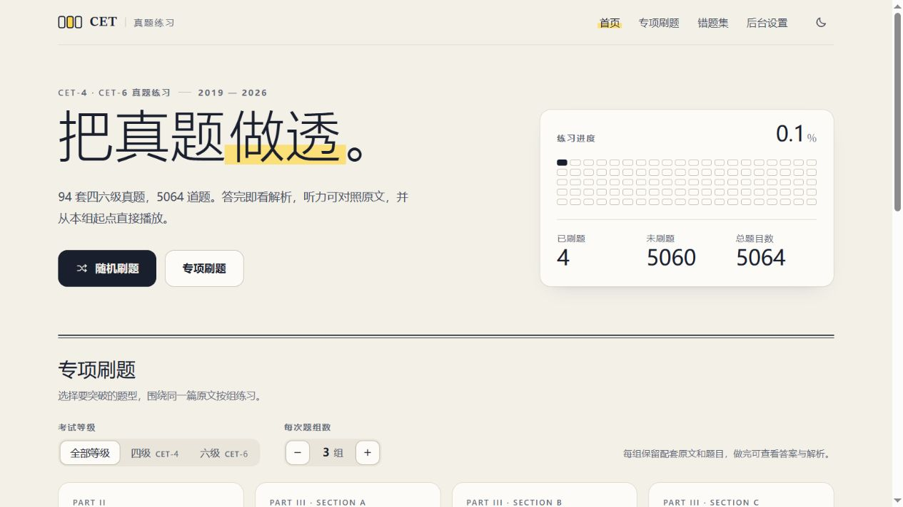
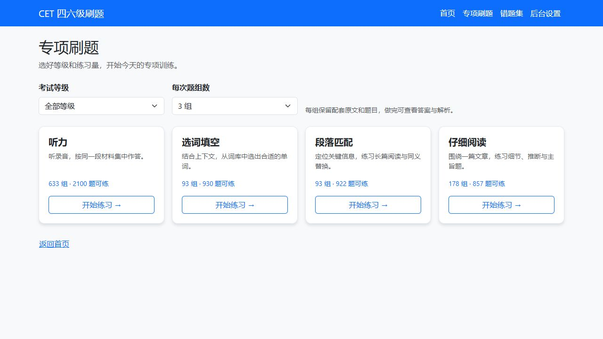
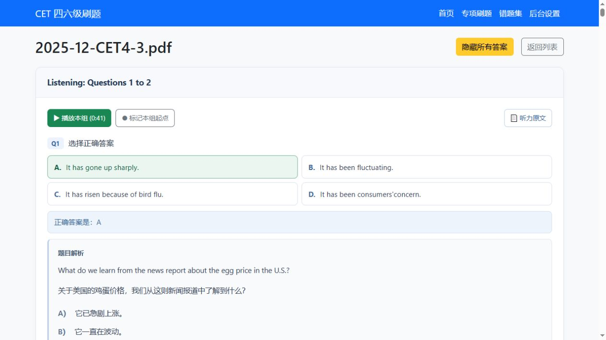
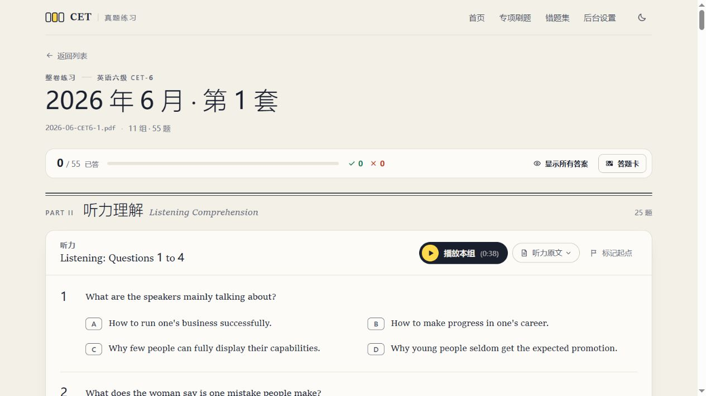

# CET-4 / CET-6 英语真题刷题系统

在浏览器里练习大学英语四、六级真题：按卷做题、集中练专项、播放听力、查看解析，并把做错的题留到下次复习。基于 Python Flask 与 SQLite，可在本地运行。

## 下载与使用

当前版本：**1.2.1**。本次补全 2020 年 12 月六级第 1 套第 26 题的解析末句，沿用下方展示的界面与常规数字字体。两个程序包适用于 Windows 10/11 x64，均为未签名便携版，解压后使用，无需安装 Python。

| 版本 | 下载 | 使用方式 |
| --- | --- | --- |
| Windows 桌面程序 | [桌面版 ZIP](https://github.com/ShepiTT/CET_practice_questions/releases/download/v1.2.1/cet-practice-1.2.1-windows-desktop-x64.zip)（834.9 MB） | 解压完整目录，双击 `CETPractice.exe`，在独立窗口中刷题；需要系统 Edge WebView2 和 .NET 运行环境。 |
| Windows 网页启动器 | [网页启动器 ZIP](https://github.com/ShepiTT/CET_practice_questions/releases/download/v1.2.1/cet-practice-1.2.1-windows-web-launcher-x64.zip)（834.9 MB） | 解压完整目录，双击 `CETPractice-Web.exe`，使用默认浏览器刷题；附带控制窗，可重新打开页面或退出服务。 |
| 源码 | [下载 1.2.1 源码](https://github.com/ShepiTT/CET_practice_questions/archive/refs/tags/v1.2.1.zip) | 按下方“快速开始”安装 Python 依赖并启动。 |

两个程序包都包含题库、94 个 MP3 及对应试卷、答案 PDF，页面样式和脚本也随包提供，可以离线练习。请保留解压后的完整目录，**不要只拷贝 EXE**。

两版本共用 `%LOCALAPPDATA%\CETPractice` 中的个人数据库，练习记录仅保存在本机。更新前先退出旧程序，将新版解压到新文件夹后启动；程序会自动备份个人数据库并追加新增试卷。1.2.1 只在题目、答案、词库及旧解析精确匹配已知缺行记录时，为 2020 年 12 月六级第 1 套 Q26（id3253）补回原 PDF 的解析末句，并清理该解析的 OCR 标题；已自行修改的解析保留，答案 A 和词库不变，练习记录与错题保留。下载包不包含发布者的个人练习记录。

关闭网页浏览器不会停止本地服务，用完请在网页启动器控制窗中点击“关闭服务”。桌面版缺少 WebView2 时，可从[微软官网下载运行环境](https://developer.microsoft.com/microsoft-edge/webview2/)，或使用网页启动器版。

版本说明和附件见 [Release 页面](https://github.com/ShepiTT/CET_practice_questions/releases/tag/v1.2.1)，下载后可使用 [SHA-256 校验文件](https://github.com/ShepiTT/CET_practice_questions/releases/download/v1.2.1/SHA256SUMS.txt) 核对文件。程序运行和自动化检查不代表全库逐题人工验收；内容核验范围见下方“数据状态与使用范围”。

打包与启动检查见 [Windows 版验证记录](reports/windows-release-validation-1.2.1.json)，公开附件大小、SHA-256 和匿名访问核验见 [下载校验记录](https://github.com/ShepiTT/CET_practice_questions/blob/main/reports/windows-release-publication-1.2.1.json)。本次单题解析更正的原 PDF 页码、哈希与改动范围见 [Q26 解析复核记录](reports/q3253-explanation-correction-20261110.json)。

## 界面展示

以下为实际运行截图。1.2.1 的界面未变，这些截图仍适用于当前版本。首页统计、年份、题号与听力时间采用常规数字字体；Windows 优先使用微软雅黑。页面提供答题进度、题号定位与可收起的原文和解析。

### 首页 · 选择等级与试卷

按四级、六级和考试场次找到试卷，也可以直接进入专项练习或错题集。



### 专项刷题 · 按题型集中练习

选择听力、选词填空、段落匹配或仔细阅读，筛选等级与题组数量；同一篇材料的题目会一起呈现。



### 听力练习 · 播放、原文与题目同页

从题组起点播放录音，按需展开听力原文和解析。共享听力会明确标注实际来源，选项与判分始终对应同一套题。



### 2026 年 6 月六级第 1 套

新增 55 道客观题，包含同卷选项、答案、解析及 7 组听力原文与播放定位。



以上为本地运行截图；GitHub 仓库提供代码与资料，不等同于已部署的公网网站。

## 主要功能

| 功能 | 使用方式 |
| --- | --- |
| 按卷练习 | 选择考试场次，按题组浏览现有听力和阅读题目。 |
| 专项刷题 | 按四级、六级或全部等级筛选，每次抽取 1–10 个题组，默认 3 组；换一批保留筛选条件。 |
| 随机练习 | 从可用题组中抽取练习，保留原文、词库、音频与解析。 |
| 听力播放 | 每组有播放按钮和起点定位，支持显示、隐藏听力原文。 |
| 作答与解析 | 提交后即时判分，可展开答案和详细解析；“显示所有答案”只查看答案，不写入练习记录。 |
| 进度与题号定位 | 查看本次已答数量和对错统计，通过答题卡跳到指定题目。 |
| 错题复习 | 按完整题组回看错题，并支持再次作答。 |
| 题库维护 | 从 PDF 导入题目，在后台手动校对或批量导入答案、解析。 |

### 省略卷如何练听力

9 份省略听力的第三套或合卷使用同场次、同等级且录音 SHA256 一致的完整来源卷。听力部分整套使用来源卷的题目、选项、答案、解析和练习记录，页面展示来源；其他题型仍使用所选试卷。

AB 卷的选项顺序可能不同，判分必须对应页面实际显示的选项。本项目的共享练习保持这两者一致，不将另一卷的答案字母套到当前选项上。该功能提供完整的听力练习，不宣称复刻省略卷未印出的独立选项顺序。

## 快速开始

仓库已包含校对后的题库及 94 套试卷对应的资料、答案 PDF 和 MP3，克隆后即可安装依赖启动，无需先重新下载或解析全部资料。分发数据库不包含个人练习历史与错题记录。

准备 Python（建议 3.10 或更新版本）和 Git，在终端执行：

```bash
git clone https://github.com/ShepiTT/CET_practice_questions.git
cd CET_practice_questions
python -m venv .venv
```

激活虚拟环境：

```powershell
# Windows PowerShell
.venv\Scripts\Activate.ps1
```

```bash
# macOS / Linux
source .venv/bin/activate
```

安装依赖并启动：

```bash
python -m pip install -r requirements.txt
python app.py
```

在浏览器打开 [http://127.0.0.1:5000](http://127.0.0.1:5000)。启动时会初始化 SQLite，并尝试导入尚未入库的 PDF；已有题目不会重新解析。解析扫描版 PDF 还需要相应 OCR 缓存或维护工具，不保证仅重新解析 PDF 就能重建全部人工校对结果。

### 补充或同步资料

需要补充四级、六级试卷、答案 PDF 和音频时运行：

```bash
python fetch_library.py --level all
```

2026 年 6 月六级第 1 套来自[懒笔记整卷及配套资源](https://english-exam.lazynote.cn/cet6/paper/2026-06-1/)，新增 55 题的选项、答案和解析已做同卷来源核对，见[内容核验](reports/cet-202606-import-content-review.json)及[正式导入记录](reports/cet-202606-import-applied.json)。写作和翻译保留在整卷 PDF 中，不提供自动判分。

此前资料来源为 [CET通](https://www.cettong.cn) 的公开仓库 [whoamiARC/cet-website](https://github.com/whoamiARC/cet-website)。工具保留已有文件，可重复运行。也可手动放入文件，并保持同名对应：

```text
data/2025-06-CET4-1.pdf
data/answers/2025-06-CET4-1.pdf
data/audio/2025-06-CET4-1.mp3
```

## 项目结构

```text
CET_practice_questions/
├── data/                 # 真题 PDF、共享听力映射
│   ├── audio/            # 听力 MP3
│   └── answers/          # 答案解析 PDF
├── docs/images/          # README 界面截图
├── instance/             # SQLite 数据库与本地运行记录
├── templates/            # 页面模板
├── scripts/              # 有证据和备份保护的数据修复工具
├── reports/              # 数据核对与验证记录
├── tests/                # 自动化测试
├── app.py                # Flask 程序与路由
├── models.py             # 数据库模型
├── parser.py             # PDF 题目提取
├── shared_listening.py   # 共享听力来源与完整性检查
├── fetch_library.py      # 同步真题、答案和音频
└── requirements.txt      # 运行依赖
```

技术栈：Flask、SQLAlchemy、SQLite、pdfplumber、Jinja2、Bootstrap 5。

## 数据状态与使用范围

截至 2026-11-10 的本地复核记录：5064 道题、703 个听力组；94 个 MP3 文件按音频哈希去重为 59 份独立录音。听力原文和播放起点均已填入，9 份省略卷可练完整 25 道共享听力题。本轮 378 项自动化测试通过，打包程序的启动与升级检查详见上方 Windows 版验证记录。

仍有部分听力逐词分歧，以及其他题型的历史缺题、排版或解析问题需要继续核对。题目数量完整、页面能打开或自动化测试通过，都不代表全库每一题已人工确认正确。

本仓库程序采用 [Apache-2.0](LICENSE) 许可证。试卷、答案和音频为第三方学习资料，权利归相应权利人；来源声明为免费、仅供个人学习使用，请遵守原始来源的使用范围。

## 导入答案

后台“一键导入”支持以下文本格式：

- `题号：第 1 题 答案：D 详解：...`
- `26 Blank 26... 答案：N (unique) ...`
- `Q1 - 第1页 ... 正确答案: B ...`

导入后应核对题号、选项与解析是否对应，特别注意不同卷的选项顺序。

## 验证与维护

运行自动化测试：

```bash
python -m pip install pytest lxml numpy beautifulsoup4 PyMuPDF
python -m pytest tests -q
```

文本排版的 JavaScript 测试还会使用本机 Node.js；未安装时对应测试会跳过。

启动本地网站后，可只读验证 9 份共享听力的 225 个题位、实际选项与答案来源，以及音频分段请求：

```bash
python scripts/validate_shared_listening.py
```

共享映射在 [data/shared_listening.json](data/shared_listening.json)，来源核对见 [共享听力来源复核](reports/shared-listening-source-review-final-20261109.json)，本次分发数据库、媒体与运行检查见 [发布验收记录](reports/github-publication-validation-20261109.json)。共享页面会检查同场次同等级、录音哈希、来源 1–25 题、四个选项及题目指纹；检查失败时显示提示并停用该共享来源。

历史答案冲突和题库修订保留在 [id4912 复核](reports/listening-4912-review.json) 与 [前期题库修订记录](reports/review-completion-applied.json)。这些是对应阶段的证据，不代表后续全库逐词、逐题验收结论。日常使用直接运行仓库中的题库即可。
